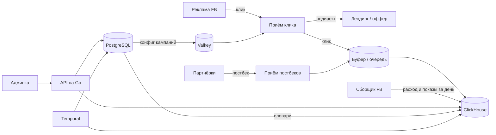

# Архитектура данных

Для дата-инженера. Контракт и код, на который ссылки, — в [backend.md](backend.md) («Where the contract lives»). Метрики считаются в `metricsOf` ([`src/mock/report.ts`](../src/mock/report.ts)), группировки и метрики перечислены в `meta.ts`, бизнес-правила — в [domain.md](domain.md). Стек: Go, PostgreSQL, ClickHouse, Valkey, Temporal, k8s.

## 1. Схема

## 2. Где что лежит

| Хранилище | Что |
|---|---|
| PostgreSQL | Все настройки: кампании, потоки, лендинги, офферы, оффер-группы и условия, партнёрки, источники, домены, пользователи, роли, доступы, кабинеты FB, провайдеры, комиссии и закрепления по периодам, проблемы, журнал. Только здесь правят данные |
| ClickHouse | События, только добавлением: клики, конверсии, расход и показы FB по объявлению за день, лог постбеков. Отчёты читают только его; имена и настройки приходят словарями из PostgreSQL |
| Valkey | Конфиг кампании для приёма клика, уникальность и привязка посетителя, счётчики кап за сегодня, лимиты потоков |
| Temporal | Проверки «Проблем» (каждые 5 мин), синк FB, повторы исходящих постбеков, алерты по капам |

## 3. Потоки

**Клик.** Маршрутизация — в domain.md. После редиректа событие клика (поля `Click` в types.ts, без `cost`: в прототипе расход на клике — упрощение) уходит в буфер и пачками в ClickHouse. `sub_id` — UUIDv7 (время внутри). Буфер должен переживать недоступность ClickHouse; асинхронная вставка без буфера теряет клики.

**Конверсия.**
- Постбек: subid, статус, выплата, tid. Ключ идемпотентности — `(sub_id, tid, status, payout)`: повтор не создаёт новое событие.
- При приёме постбека в событие копируются поля клика (кампания, поток, оффер, лендинг, ad id, гео, время клика, байер), чтобы отчёт не соединял конверсии с кликами по `sub_id`.
- Одна конверсия меняет статус (рега → деп → отказ). События пишутся в `conversion_events`, текущий статус — в `conversions_current` (§4). Метрики считаются только по текущему статусу.
- Отказ заменяет статус: деп исчезает из «Лидов» и «Продаж», CR после отказа падает.
- Статусы `rebill`, `registration`, `deposit` из `ConversionStatus` отчёты не считают: решить, во что их переводить, или убрать.
- Отчёт считает конверсию на дату и в разрезах **её клика**. Лог конверсий — по дате постбека. Капы — по дате депа в поясе оффер-группы. Ставка — по условиям оффер-группы на дату постбека.
- Отклонения от финансов (CSV `subid, status, payout, tid, reason`) — обычные события.

**Расход FB.**
- Сборщик присылает дерево `кабинет › кампания › адсет › объявление` и по объявлению за день показы и расход. День — в поясе кабинета; клик относится к дню FB по своему времени в поясе кабинета.
- FB дописывает статистику до 28 дней назад: сборщик перезаливает окно 28 дней.
- Связь: клик → объявление по `sub_id_6`; кампания FB → кампания трекера по id в начале её названия. Нет id → расход **нераспределённый** (`spend_diff`).
- Расход и показы объявления за день делятся между его кликами этого дня поровну; расход без кликов идёт в строку «—» и в «Итого». Почасовой расход — по доле кликов.
- «Расход+%» = расход × (1 + комиссия дня). Комиссия — последняя строка `AdFeePeriod` с датой начала не позже дня; строка кабинета важнее строки провайдера.
- **Байер** (решено, §7). Клики и выплаты принадлежат байеру клика (владелец кампании на момент клика), даже если депозит пришёл после передачи кабинета. Расход — байеру, за которым кабинет закреплён в этот день.
- Валюта, пояс и дата создания кабинета берутся из FB API (`currency`, `timezone_name`, `created_time`).

**Валюта** (решено, §7). Все отчёты в USD. Расход приходит в валюте кабинета, выплаты — в `payout_currency` оффера. Хранится исходная сумма и валюта, а в USD сумма переводится при чтении по среднему курсу месяца: словарь `month × валюта → курс`. Так смена курса не требует перезаписи событий. Курс текущего месяца до его конца неизвестен: на это время берётся средний курс прошлого месяца, а после закрытия месяца ставится фактический средний. Фактический курс партнёрки в отчётах не учитывается: разницу считают финансы.

## 4. ClickHouse (черновик)

| Таблица | Движок и ключ | Партиции, срок | Заметки |
|---|---|---|---|
| `clicks` | MergeTree, `ORDER BY (campaign_id, datetime)` | по месяцу; TTL = «Хранить статистику» (сейчас 365 дн.), `ttl_only_drop_parts=1` | `bloom_filter` по `sub_id`, `ip`; повторяющиеся строки → `LowCardinality(String)` |
| `conversion_events` | MergeTree, `ORDER BY (sub_id, tid, postback_datetime)` | по месяцу | Только добавление, с полями клика |
| `conversions_current` | ReplacingMergeTree(version), `ORDER BY (sub_id, tid)` | без партиций по постбеку (или по месяцу клика), чтение с `FINAL` | Версия = (время постбека, номер приёма); иначе рега и деп из разных месяцев не схлопнутся |
| `fb_day_stats` | ReplacingMergeTree(updated_at, is_deleted), `ORDER BY (ad_id, day)` | по месяцу, чтение с `FINAL` | Без `FINAL` перезалитые дни считаются дважды |
| `lp_clicks` | MergeTree, `ORDER BY (campaign_id, datetime)` | по месяцу, TTL как у `clicks` | Клик по лендингу — отдельное событие: `sub_id` клика, время, лендинг, оффер и поля клика для разрезов. «Клики по ЛП» и LP CTR считаются по нему |
| `postback_log` | MergeTree, `ORDER BY datetime` | TTL 30–90 дней | Входящие и исходящие, HTTP-код, ответ |
| словари | кампании, потоки, офферы, группы, лендинги, пользователи, дерево FB; комиссии и закрепления — `RANGE_HASHED` по датам | `LIFETIME(MIN 60 MAX 300)` | Обновляются самим ClickHouse |

- **Сроки хранения.** Изменение «Хранить статистику» = `ALTER TABLE … MODIFY TTL`. Для `conversion_events` и `fb_day_stats` срок задать отдельно. Решить, что делать с конверсией, чей клик уже удалён.
- **Агрегаты.** При ~8 млн кликов в год отчёты читают сырые таблицы, агрегаты не нужны. Вернуться к ним, только если отчёт за 90 дней не уложится в порог. Тогда учесть: материализованное представление видит только новые клики, а поздним конверсиям нужен свой агрегат по дате и разрезам клика.
- **Загрузка истории.** Первая загрузка истории FB и пересчёт агрегатов за прошлые даты после поздних конверсий.
- **Персональные данные.** IP и User-Agent — персональные данные: задать срок хранения сырого IP или маскировать его через N дней.

## 5. Отчёт

Запрос `reports.build(ReportRequest)`: период и пояс, группировки (одна на уровень; раскрытие строки — новый запрос с фильтром по родителю, до 10 уровней), метрики, фильтры, сортировка, лимит. Ответ — строки и «Итого». Время хранится в UTC, дни и часы считаются в поясе запроса.

Правила, которые не видны из названий метрик (остальное — `metricsOf`):
- Проценты (CR, ROI…) считаются по суммам группы, не средним по строкам. `i2d` — отношение, не процент.
- «Лиды» = реги + депы (деп был регой). «Подтв.» = только депы (`sale`). «Все» = выплаты рег и депов.
- Варианты с комиссией (`cost_fee`, `profit_fee`, `roi_fee`) считаются от подтверждённого дохода и расхода с комиссией дня.
- Показы, CTR, CPM — из `fb_day_stats` по правилу деления (§3).
- «Не учитывать в статистике»: кампания пропускается, если нет `include_excluded` и нет фильтра по самой кампании.
- Теги: клик кампании с несколькими тегами попадает в каждый тег (`arrayJoin`), а «Итого» считается без размножения. Фильтр по тегу срабатывает, если подходит хотя бы один тег; при группировке по тегу с фильтром строками становятся только подходящие теги. Теги без запятых, до 40 символов, «—» зарезервирован под «без тегов».
- Доступ: сервер добавляет фильтр видимых кампаний (роль и отдельные доступы). Скрытые метрики роли убираются вместе с производными: скрыта выплата → скрыты прибыль, ROI, EPC, uEPC, средний чек.
- Фильтры — по id, имена подставляются словарём (в прототипе — по именам).

## 6. Valkey

| Ключ | Значение | Срок |
|---|---|---|
| `camp:{alias}` | Конфиг кампании: потоки, фильтры, веса, доли, офферы с гео | Сброс при сохранении кампании, потока, оффера |
| `uniq:{campaign}:{visitor}` | Уже был + привязка (поток, лендинг, оффер) | Срок уникальности кампании |
| `cap:{offer_group}:{day}` | FTD и инсталлы за день | 2 суток |
| `rl:…` | Лимиты потоков | Окно лимита |

При переключении на реплику ключи `uniq:` могут потеряться — уникальных кликов станет больше. Это допустимо, но должно быть записано. Капы за весь период считаются из ClickHouse, Valkey только кэширует сегодня.

## 7. Решения и открытые вопросы

Ответы AAA 17/11:

| # | Вопрос | Решение |
|---|---|---|
| 1 | Объём | 4 тыс. уникальных и 11 тыс. всех кликов в день; через год ×2. Это ~8 млн строк в год: один узел ClickHouse, без шардирования и агрегатов |
| 2 | Клик по лендингу | Отдельное событие (`lp_clicks`, §4) |
| 3 | Сборщик FB: куда и в каком формате пишет | Выбирает DE |
| 4 | Буфер кликов | Выбирает DE. При таком объёме подойдёт самый простой надёжный вариант |
| 5 | Параллельная работа с Keitaro | Не нужна |
| 6 | Поиск по логам | Как в Keitaro: по subid, IP и полям клика в ClickHouse. OpenSearch не нужен |
| 7 | Байер при смене кабинета | Выплата засчитывается байеру клика, по которому пришёл постбек, даже если кабинет уже передан. Расход дня — тому, за кем кабинет закреплён в этот день |
| 8 | Валюта | Всё в USD по среднему курсу месяца. Фактический курс партнёрки в трекер не идёт: разницу считают финансы |

Открыто: источник курсов (API курсов или ручной ввод финансами) и подтверждение правила расхода в п. 7.
