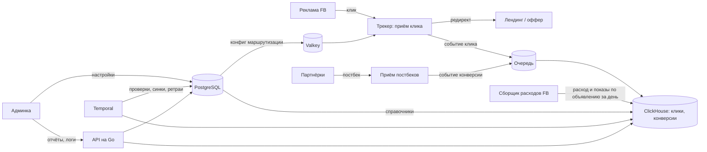

# Архитектура данных трекера

Для дата-инженера: откуда приходят данные, где лежат, как считаются отчёты. Прототип интерфейса уже готов, он работает на тестовых данных в браузере. Код, на который здесь ссылки, — это и есть договорённость о данных:

| Что | Где |
|---|---|
| Все сущности и поля | [`src/api/types.ts`](../src/api/types.ts) |
| Все запросы интерфейса к серверу (161 функция) | [`src/api/client.ts`](../src/api/client.ts) и `client-*.ts` |
| Как считается каждая метрика отчёта | [`src/mock/report.ts`](../src/mock/report.ts) |
| Список группировок и метрик | [`src/api/meta.ts`](../src/api/meta.ts) — `DIMENSIONS`, `METRICS` |
| Кто что видит | [`src/mock/scope.ts`](../src/mock/scope.ts) |
| Бизнес-правила | [domain.md](domain.md), для бэкенда — [backend.md](backend.md) |

Стек решён CTO: Go, PostgreSQL, ClickHouse, Valkey, Temporal, OpenSearch, k8s.

## 1. Картина целиком

**Главное правило:** настройки (кампании, потоки, офферы, пользователи) живут в PostgreSQL. События (клики, конверсии, расходы) пишутся только добавлением в ClickHouse. Отчёты читают только ClickHouse, а справочники из PostgreSQL подтягивают туда словарями (dictionaries).

## 2. Где что хранится

| Хранилище | Что | Почему там |
|---|---|---|
| PostgreSQL | Кампании, потоки, лендинги, офферы, оффер-группы и их условия (капы, ставки по периодам), партнёрки, источники, домены, пользователи, роли, доступы, кабинеты FB, провайдеры и комиссии по периодам, закрепления кабинетов за байерами, проблемы, журнал действий | Мало строк, частые правки, нужны связи и транзакции |
| ClickHouse | Клики, события конверсий, расход и показы FB по объявлению за день, лог постбеков | Сотни миллионов строк, отчёты по любым разрезам за секунды |
| Valkey | Готовый конфиг маршрутизации кампании, уникальность и привязка посетителя, счётчики кап на сегодня, лимиты | Нужен ответ за миллисекунды на каждый клик |
| Temporal | Фоновые задачи: проверки проблем каждые 5 минут, синк FB, повторы исходящих постбеков, алерты по капам | Повторы, расписание, видно, что упало |
| OpenSearch | Поиск по логам кликов по subid, IP, user agent и полнотекстом (если ClickHouse не справится) | Опционально: сначала проверить, хватит ли ClickHouse |

## 3. Потоки данных

### Клик
1. Посетитель приходит по ссылке `https://домен/алиас?sub_id_1=…`. Сервис приёма берёт конфиг кампании из Valkey (если там нет — из PostgreSQL), проверяет фильтры потоков, выбирает поток по весу и выбирает лендинг и оффер по долям. Гео оффера ограничивает выбор: оффер с капой на штаты получает только клики из своих штатов.
2. Уникальность и привязка: ключ посетителя (IP + User-Agent, cookie или параметр — задаётся в кампании) хранится в Valkey со сроком «срок уникальности». Вернувшийся посетитель идёт в тот же поток, лендинг и оффер.
3. Редирект: только HTTP 302, JS или «без реферера».
4. Событие клика уходит в очередь, затем в ClickHouse пачками. Состав полей — `Click` в types.ts: subid, время, id кампании, потока, лендинга, оффера и источника, гео, устройство, версии, user agent, язык, ISP, оператор, реферер, `sub_id_1…30`, external_id, бот, признаки уникальности, клик по лендингу.
5. Клик по лендингу (переход с лендинга на оффер) — отдельное событие с тем же subid. В ClickHouse его удобно хранить строкой `lp_click` или обновлять клик через ReplacingMergeTree; выбрать нужно до старта.

### Конверсия
1. Партнёрка шлёт постбек: subid, статус, выплата, tid. Статусы партнёрки переводятся в наши: `lead` (рега), `sale` (деп), `rejected`.
2. Одна конверсия меняет статус со временем: рега в октябре может стать депом в ноябре. Поэтому пишем **события** (`conversion_events`: subid, tid, статус, выплата, время постбека, причина отказа), а текущий статус собираем отдельным представлением (`argMax` по времени или ReplacingMergeTree по `(sub_id, tid)`).
3. Атрибуция: в отчётах конверсия считается на дату и в разрезах **её клика**. Лог конверсий фильтрует по дате постбека, капы считают по дате депа в часовом поясе оффер-группы.
4. Ставка депа — по условиям оффер-группы, которые действуют на дату постбека, а не «ставка сейчас».
5. Исходящие постбеки (пиксель через CAPI, PWA, вебхуки) уходят по статусам, до 5 повторов (Temporal). Каждая попытка пишется в лог постбеков.
6. Финансы загружают отклонения CSV-файлом (`subid, status, payout, tid, reason`). Это обычные события конверсий.

### Расход FB
1. Сборщик команды присылает дерево `кабинет › кампания FB › адсет › объявление` и за каждый день по объявлению показы и расход (`FbDayStat`). День — в часовом поясе кабинета.
2. Клик связан с объявлением через `sub_id_6` (ad id). Расход — это отдельная таблица, а не поле клика: так расход без кликов не теряется, а суммы сходятся с кабинетом.
3. Кампания FB связана с кампанией трекера через id трекера в начале названия FB-кампании (`<id> | <дата> | …`). Если id нет или он неизвестен, расход считается **нераспределённым** (`spend_diff`) и показывается по кабинету.
4. «Расход+%» = расход × (1 + комиссия провайдера на этот день). Комиссия берётся по периодам из `AdFeePeriod`: строка кабинета важнее строки провайдера, берётся последняя дата начала, которая не позже этого дня.
5. Байер дня — по закреплению кабинета на этот день (`AdAccountAssignment`).
6. Валюту, часовой пояс и дату создания кабинета трекер берёт из FB API сам.

## 4. Таблицы ClickHouse (черновик)

| Таблица | Движок / ключ сортировки | Партиции и срок | Заметки |
|---|---|---|---|
| `clicks` | MergeTree, `ORDER BY (campaign_id, datetime, sub_id)` | по месяцу; TTL = «Хранить статистику, дней» из настроек (сейчас 365) | Поля как `Click`. Низкая кардинальность (`os`, `browser`, `country`) → `LowCardinality(String)` |
| `conversion_events` | MergeTree, `ORDER BY (sub_id, tid, postback_datetime)` | по месяцу | Только добавление. Текущий статус — представление `conversions_current` |
| `fb_day_stats` | ReplacingMergeTree(updated_at), `ORDER BY (ad_id, day)` | по месяцу | Сборщик перезаливает последние дни: дубль заменяет строку |
| `postback_log` | MergeTree, `ORDER BY (datetime)` | TTL 30–90 дней | Входящие и исходящие постбеки, HTTP-код, ответ |
| словари | `campaigns`, `streams`, `offers`, `offer_groups`, `landings`, `users`, `fb_ads → adset → campaign → account`, `ad_fee_periods`, `ad_assignments` | обновление раз в 1–5 мин из PostgreSQL | Имена, теги, байер, команда, «не учитывать в статистике», комиссии по датам |

Отчётам по большим периодам почти наверняка понадобятся агрегаты: материализованное представление «клики по часу × кампания × поток × оффер × гео × устройство» с суммами. Решать по объёмам.

## 5. Как строится отчёт

Интерфейс шлёт один запрос `reports.build(ReportRequest)`: период и часовой пояс, группировки (одна на уровень, при раскрытии строки — новый запрос с фильтром по родителю), метрики, фильтры, сортировка, лимит. Ответ — `ReportResponse`: строки и строка «Итого». Метрики-проценты (CR, ROI…) считаются по суммам группы, а не как среднее по строкам.

| Метрика | Формула |
|---|---|
| Клики, уник., боты, клики LP | количество кликов / с признаком |
| Лиды (реги) | конверсии `lead` + `sale` (деп был регой) |
| Продажи (депы) | конверсии `sale` |
| Отклонено | конверсии `rejected`; потерянная выплата — `rejected_revenue` |
| Доход подтв. | сумма выплат `sale`; Доход (все) = выплаты `lead` + `sale` |
| Расход | сумма расхода; Расход+% — с комиссией дня |
| Прибыль подтв. | доход подтв. − расход; ROI подтв. = прибыль / расход × 100 |
| CR / CRs / апрув | лиды / клики; продажи / клики; продажи / лиды (×100) |
| EPC, uEPC | доход подтв. / клики; / уник. клики |
| CPC / CPA / CPS | расход / клики / лиды / продажи |
| Показы, CTR, CPM | из `fb_day_stats`: клики / показы, расход / показы × 1000 |
| c2i, i2r, i2d, цена инсталла | уник. / клики; лиды / уник.; уник. / продажи; расход / уник. |

Точные формулы — `metricsOf` в [`src/mock/report.ts`](../src/mock/report.ts).

Особые правила:
- **Часовой пояс.** Время хранится в UTC. Дни и часы считаются в поясе из запроса (`toTimeZone`). Капы — в поясе оффер-группы, FB — в поясе кабинета.
- **«Не учитывать в статистике».** Кампании с этим флагом пропускаются, если в запросе нет `include_excluded` и нет фильтра по самой кампании.
- **Теги.** Группировка «Тег кампании»: клик кампании с несколькими тегами попадает в каждый тег (`arrayJoin`), фильтр срабатывает, если подходит хотя бы один тег.
- **Доступ.** Сервер сам добавляет фильтр «видимые кампании»: роль (свои, группы, все) и отдельные доступы к кампании или группе. Скрытые метрики роли (например, выплаты) убираются из ответа на сервере.
- **Фильтры по id.** В прототипе фильтры идут по именам. В рабочей версии фильтровать по id, а имена подставлять словарём.

## 6. Valkey: ключи (черновик)

| Ключ | Значение | Срок |
|---|---|---|
| `camp:{alias}` | Конфиг кампании: потоки, фильтры, веса, доли, офферы с гео | Сбрасывается при сохранении кампании, потока или оффера |
| `uniq:{campaign}:{visitor}` | Признак «уже был» + привязка (поток, лендинг, оффер) | Срок уникальности кампании |
| `cap:{offer_group}:{day}` | Счётчик FTD и инсталлов за день | 2 суток |
| `rl:…` | Лимиты потоков (кликов в час, в сутки) | Окно лимита |

Капы за весь период условий надёжнее считать из ClickHouse раз в минуту (Temporal), а Valkey держать как быстрый кэш на сегодня.

## 7. Фоновые задачи (Temporal)

| Задача | Частота |
|---|---|
| Проверки проблем: партнёрка молчит, нейминг, расход без кликов, клики без ad id, ошибки постбеков, капа, условия заканчиваются, нераспределённый расход, ошибка FB API, домен или SSL | каждые 5 мин |
| Синк FB: баланс, статус кабинета, валюта и часовой пояс | каждые 15–60 мин |
| Исходящие постбеки: повторы | до 5 попыток с паузами |
| Алерты по капам в Telegram (50, 80, 90, 100%) | при пересчёте капы |
| Обновление словарей в ClickHouse | 1–5 мин |
| Чистка по сроку хранения | раз в сутки |

## 8. Открытые вопросы (решить до старта)

1. **Объём.** Сколько кликов в день сейчас и через год? От этого зависят агрегаты, шардирование и срок хранения сырых кликов.
2. **Клик по лендингу:** отдельной строкой или обновлением клика?
3. **Сборщик расходов FB:** он пишет прямо в ClickHouse или через наш API? Какой формат и как часто перезаливает прошлые дни?
4. **Очередь** между приёмом кликов и ClickHouse: Kafka, NATS или Redpanda? Или ClickHouse async insert без очереди?
5. **История Keitaro не переносится** (так решено). Нужен ли период, когда Keitaro и трекер работают параллельно и сверяются цифры?
6. Нужен ли **OpenSearch** для лога кликов, или хватит ClickHouse с `ngrambf_v1` / `tokenbf_v1` индексами по subid и IP.
